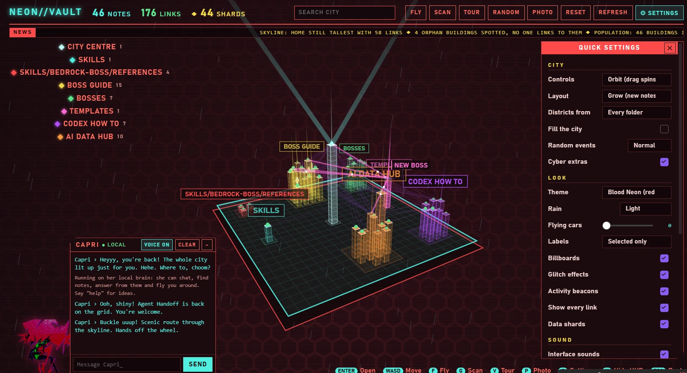

# Neon Vault City

Explore your Obsidian vault as a holographic 3D cyberpunk city. Every note is a building, taller buildings have more links, and folders (or tags) become districts. Capri, your holographic guide, chats, finds notes, answers questions from them and flies you around.

## Install
1. Create a `neon-vault-city` folder in your vault's `.obsidian/plugins/` folder and put `main.js`, `manifest.json` and `styles.css` in it (from this repository or its latest release).
2. In Obsidian: Settings → Community plugins → turn off Restricted mode if needed → click the refresh icon → turn on **Neon Vault City**.
3. Click the building icon in the left ribbon, or run **Neon Vault City: Open city** from the command palette (Ctrl+P).

## Getting around
| Input | Does |
|---|---|
| Drag | Slide the city like a map |
| Right-drag / Q, E | Turn the city |
| Scroll | Zoom |
| WASD | Move |
| Click / double-click | Select a building / open its note |
| F | Fly mode (Space up, C down) |
| G | Scan: orphan notes red, recently edited green |
| V | Skyline tour |
| X | Random note |
| P | Save a snapshot to `City Snapshots/` |
| O | Quick settings |
| H | Hide the HUD |
| Esc | Back |

Spinning diamonds are **data shards** over older notes. Click one to collect it and rediscover the note.

## A city that grows
- With the **Grow** layout (default), every building keeps its spot. Older notes sit in the middle of each district and new ones are built on the outskirts, so the city expands outward as your vault grows.
- New notes rise out of the ground as construction sites with scaffolding and sparks. A new folder gets a **NEW DISTRICT ZONED** alert.
- **Fill the city** surrounds your notes with a background megacity skyline, so even a small vault looks packed.

## Random events
Every few minutes Capri goes a little wild (set the rate to Off, Rare, Normal or Chaos):
- **Fix-it jobs:** she flies to a building and "repairs" it, with sparks and a progress bar. Results not guaranteed.
- **Glitch storms**, **blackouts**, **dance parties** with fireworks, **joyrides** around the skyline and **power surges**.

You can also ask for them: "go wild", "fix <note>", "party", "lights out", "joyride", "storm".

## Capri
- Works offline with no setup. She chats ("heyy", "how are you", "tell me a joke", "fun fact", "rate my vault", "flip a coin"...) and copes with stretched letters and small typos ("how are youu", "hahah"). She also finds things: "find <words>", "what is <topic>", "take me to <note>", "open <note>", "scan", "tour" or "surprise me".
- Say "shut up" to silence her voice and her own comments, and "talk to me" to bring her back.
- Optional extras in Settings → Neon Vault City:
  - **Claude API key** for full AI conversation (billed to your key).
  - **Voice**: Windows voices (default) or a Fish Audio voice (your own API key and voice ID, see below).
- To change her look, put a square PNG with a transparent background named `avatar.png` (standing) and, optionally, `avatar-perch.png` (crouching) in this folder.

## Give Capri a custom voice (Fish Audio)
Fish Audio lets you make or pick a voice and use it through its API.

1. **Sign up** at [fish.audio](https://fish.audio/app/).
2. **Get a voice.** Either:
   - **Design a new one:** create a voice from a written description, for example *"young woman, bright and playful, quick and expressive, a little mischievous"*. Try a few versions and keep your favourite.
   - **Pick one from the voice library**, choosing voices whose creators allow use.
   
   Only use voices you have the right to use. Don't clone a real person's voice, or a game or film character's, without their permission.
3. **Copy the voice ID.** Open the voice's page; the ID is the long code in the address, after `/m/`. For example, in `fish.audio/app/m/0123abcd…/` the ID is `0123abcd…`.
4. **Create an API key** in the API keys section of your Fish Audio account. Keep it secret.
5. **In Obsidian:** Settings → Neon Vault City → Avatar → set **Voice engine** to **Fish Audio**, paste your **API key** and **Voice ID**, then press **Test**.
6. **Tune it** with **Pitch lift** and **Voice effect** (hologram shimmer, radio crackle or none).

If it still sounds like the Windows voice, look in Capri's chat for a grey "Fish Audio voice unavailable (…)" line: the part in brackets says why (for example a rejected key or no credit left). Fish Audio has a free model with limited use; check their pricing for current limits.

## Settings
Theme, rain, flying cars, billboards, glitch effects, layout, district grouping (top folders, every folder or first tag), the filler skyline, random events, cyber extras (boot sequence, news ticker, holographic ads, searchlights), labels, sounds and Capri's voice and personality are all in the in-city **⚙ SETTINGS** panel or under Settings → Neon Vault City.

API keys you enter are saved in `.obsidian/plugins/neon-vault-city/data.json`. Don't share that file.

## Privacy and network use
Out of the box, Neon Vault City works fully offline and for free: the city, Capri's built-in local brain (chat, finding notes and answering from them) and the Windows voice need no account, no payment and no internet. It reads your notes locally and sends nothing anywhere. There is no telemetry.

**Payment and accounts:** Capri's full AI conversation is optional and needs a Claude API account from Anthropic, which is paid per use. The Fish Audio voice is optional and needs a Fish Audio account and API key. Nothing else needs an account.

Network use only happens when you turn on these optional features yourself:

| Feature | Why it needs the network | What is sent, and where | Account or key |
|---|---|---|---|
| Claude API (Capri's full AI chat) | The AI model runs on Anthropic's servers | Your chat messages, and the text of notes Capri reads to answer you, to `api.anthropic.com` | Your own Claude API key; usage is billed to it |
| Fish Audio voice | The voice is generated on Fish Audio's servers | The text of Capri's replies, to `api.fish.audio` | Your own Fish Audio API key |

The plugin never reads or writes anything outside your vault. Files it writes inside your vault:
- `City Snapshots/` when you take a photo (P)
- new notes, or text added to the end of existing notes, only when you ask Capri to add something while the Claude API is on

## Licence
MIT. See [LICENSE](LICENSE).
